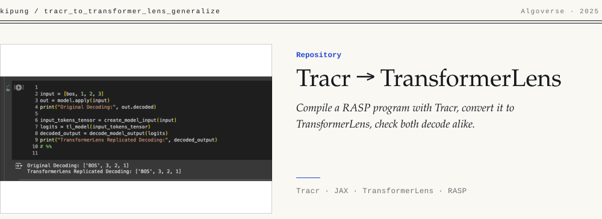

<picture><source media="(max-width: 640px)" srcset=".github/banner-m-light.svg"><source media="(prefers-color-scheme: dark)" srcset=".github/banner-dark.svg"></picture>

[Tracr](https://github.com/deepmind/tracr) compiles programs written in **RASP** into real transformer weights in JAX. [TransformerLens](https://github.com/TransformerLensOrg/TransformerLens) is the standard PyTorch library for mechanistic interpretability. This notebook connects the two. It compiles a RASP program, converts the weights into a `HookedTransformer`, and checks that the two models agree. The result is a transformer whose algorithm you already know, ready to study with interpretability tools.

The conversion is **parametric**. One flag switches the program.

| Program | Expected behavior | What to look for |
| --- | --- | --- |
| `identity` | Output equals input | Attention close to the identity; diagonal residual stream |
| `reverse` | Output is the input reversed | Attention routes across the sequence; anti-diagonal residual stream |

## How it works

1. Compile the RASP program with Tracr.
2. Read the model config and create a blank `HookedTransformer`.
3. Reshape the Tracr state dict so every attention weight has an `n_heads` dimension, then load it.
4. Run both models on the same input and compare the decoded outputs.
5. Compare cached activations layer by layer (attention and MLP) within a tolerance.

For `reverse` on `[BOS, 1, 2, 3]`, the Tracr reference and the TransformerLens replica both decode `['BOS', 3, 2, 1]`, as the banner shows.

## Run

Open `Tracr_to_Transformer_Lens_Parametric_Demo_Documented.ipynb` in Colab or Jupyter (Python 3.8+). The notebook installs Tracr and TransformerLens.

**Troubleshooting.** Disable causal masking for non-causal programs. The compiler can optimize away very simple programs, such as raw `tokens`; add an explicit self-attention to keep the structure.

Built during the Algoverse AI Research program (2025).
